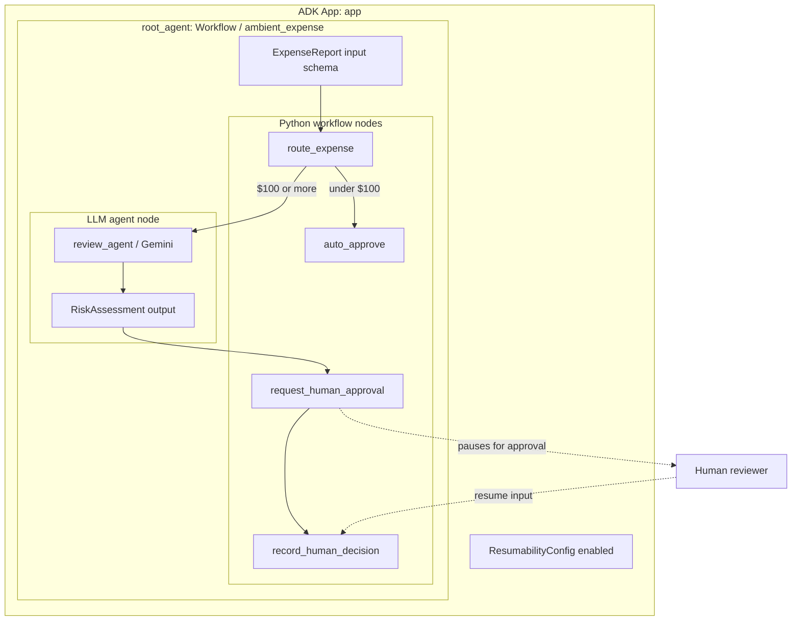
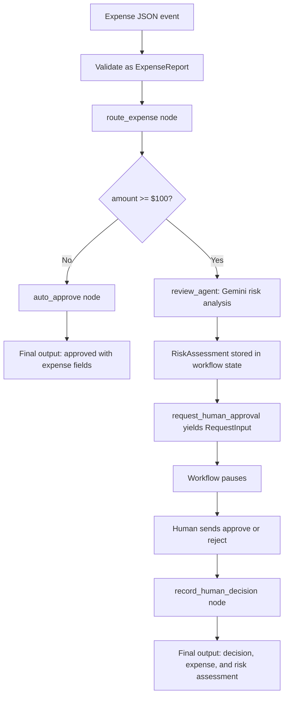

# ambient-expense

An expense approval workflow built with the ADK 2.0 graph API. Expenses under
$100 are auto-approved in Python without an LLM call. Expenses of $100 or more
are assessed by a Gemini risk reviewer, then the workflow pauses for a human
approval decision.

Generated with `agents-cli` version `1.15.0`.

## Project Structure

```
ambient-expense/
├── app/
│   ├── agent.py               # Expense workflow and routing rules
│   ├── fast_api_app.py        # FastAPI server and A2A routes
│   └── app_utils/             # Server utilities
├── deployment/terraform/      # Terraform deployment configuration
├── tests/
│   ├── eval/                  # Agent evaluation configuration and data
│   ├── integration/           # Workflow and server integration tests
│   └── unit/                  # Workflow node tests
├── GEMINI.md                  # AI-assisted development guide
└── pyproject.toml             # Project dependencies and tooling
```

> 💡 **Tip:** Use [Antigravity CLI](https://antigravity.google/) for AI-assisted development - project context is pre-configured in `GEMINI.md`.

## Requirements

Before you begin, ensure you have:
- **uv**: Python package manager (used for all dependency management in this project) - [Install](https://docs.astral.sh/uv/getting-started/installation/) ([add packages](https://docs.astral.sh/uv/concepts/dependencies/) with `uv add <package>`)
- **agents-cli**: Agents CLI - Install with `uv tool install google-agents-cli`
- **Google Cloud SDK**: For GCP services - [Install](https://cloud.google.com/sdk/docs/install)


## Quick Start

Install `agents-cli` and its skills if not already installed:

```bash
uvx google-agents-cli setup
```

Install required packages:

```bash
agents-cli install
```

Test the agent with a local web server:

```bash
agents-cli playground
```

You can also use features from the [ADK](https://adk.dev/) CLI with `uv run adk`.

## Workflow

Submit an expense report as a JSON object with all five required fields:

```json
{
  "amount": 125.50,
  "submitter": "alex@example.com",
  "category": "travel",
  "description": "Conference travel",
  "date": "2026-11-20"
}
```

The Python rule in `app/agent.py` routes amounts below `$100` directly to an
approved result. Amounts of `$100` or more go to the LLM risk reviewer. The
reviewer reports a risk level, factors, and summary; it does not make the
approval decision. The ADK app is resumable and pauses at `RequestInput` until a
human responds with `{"decision": "approve"}` or `{"decision": "reject"}`.

The threshold is `REVIEW_THRESHOLD` in `app/agent.py`. The review model is
configured by `MODEL` in the same file. A low-value event can run without model
credentials; a high-value review requires credentials for the configured Gemini
model.

### High-Level Structure

`root_agent` is the workflow; `review_agent` is the LLM agent nested in that
workflow. The human reviewer responds from outside the workflow, which is
resumable through the app configuration.



### Data Flow



## Commands

| Command | Description |
| --- | --- |
| `agents-cli install` | Install project dependencies using uv. |
| `agents-cli playground` | Launch the local ADK development environment. |
| `uv run pytest tests/unit tests/integration/test_agent.py -q` | Run unit tests and the expense workflow integration test. |
| `uv run pytest tests/unit tests/integration -q` | Run all tests; server E2E tests require Google Application Default Credentials. |
| `agents-cli lint` | Run code quality checks. |
| `agents-cli eval` | Evaluate agent behavior; see `agents-cli eval --help`. |
| `agents-cli deploy` | Deploy the agent to Cloud Run. |

## 🛠️ Project Management

| Command | What It Does |
|---------|--------------|
| `agents-cli scaffold enhance` | Add CI/CD pipelines and Terraform infrastructure |
| `agents-cli infra cicd` | One-command setup of entire CI/CD pipeline + infrastructure |
| `agents-cli scaffold upgrade` | Auto-upgrade to latest version while preserving customizations |

---

## Development

Edit the workflow in `app/agent.py`. The FastAPI server is defined in
`app/fast_api_app.py`. Use `agents-cli playground` to try the workflow locally;
submit a JSON expense report as the input.

## Deployment

```bash
gcloud config set project <your-project-id>
agents-cli deploy
```

To add CI/CD and Terraform, run `agents-cli scaffold enhance`.
To set up your production infrastructure, run `agents-cli infra cicd`.

## Observability

Built-in telemetry exports to Cloud Trace, BigQuery, and Cloud Logging.

## A2A Inspector

This agent supports the [A2A Protocol](https://a2a-protocol.org/). Use the [A2A Inspector](https://github.com/a2aproject/a2a-inspector) to test interoperability.
See the [A2A Inspector docs](https://github.com/a2aproject/a2a-inspector) for details.
